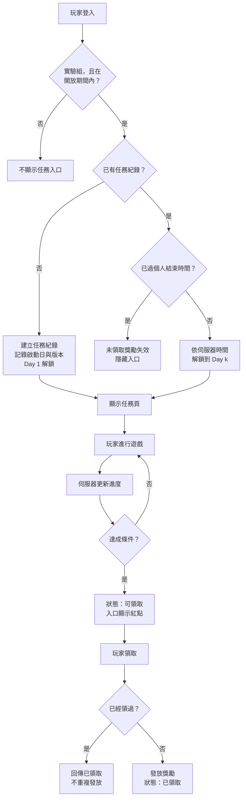

# PRD｜七日任務系統

| 項目 | 內容 |
|---|---|
| 文件狀態 | v0.3（決策紀錄見 §14） |
| 作者 | Deciii |
| 最後更新 | 2026-11-08 |
| 產品 | 某款休閒手遊（駐點客戶專案，已去識別化） |
| 相關角色 | Client RD、Server RD、UI、QA、營運 |
| 版本範圍 | v1.0 核心任務系統（MVP）／v1.1 分眾任務 |

> **關於這份文件**
> 這是作品集用的 PRD 練習。原型是我在現職的駐點客戶專案中參與的「七日任務」需求。當時我的角色是工程師，負責評估規格，並協助定義必須在一週內完成的核心範圍。
> 專案名稱與所有數值都已去識別化或改為示意。這份文件從 PM 的角度重寫一次：如果一開始就把規格寫成這樣，可以避免哪些反覆修改。
> 和原專案的差異只有一處：§2 加上了 A/B 對照組，原專案沒有保留。

---

## 1. 背景

### 1.1 要解決的問題
新玩家在註冊後的前幾天流失最多。這個需求希望透過「連續多天、每天都有新任務和獎勵」的設計，給玩家每天回來的理由，提升次日留存（D1）與七日留存（D7）。

### 1.2 原始需求與本規格的差異
原始需求是「依受眾（新手、老手）提供不同的七日任務」，預計一週內上線。評估後發現四個問題：

| 問題 | 影響 |
|---|---|
| 「新手」「老手」沒有可以計算的定義 | 開發途中定義一改，判定邏輯和測試案例都要重做 |
| 沒說明玩家身份轉換後（新手隔天就變老手），兩組任務是否並存 | 牽涉資料結構與 UI，屬於破壞性修改 |
| 「前往」跳轉的目的地沒有限定範圍 | 每加一種目的地都要改客戶端 |
| 上線時間固定一週 | 規格持續變動的情況下，無法完成全部功能 |

因此拆成兩個版本：

- **v1.0（本次上線）**：可設定持續天數的任務系統，所有玩家使用同一組任務。這已經足以驗證核心假設：「每天都有任務，能否提升留存」。
- **v1.1（擴充）**：分眾任務。等 v1.0 上線後，把身份定義和互斥規則定清楚（§10）再開發。

---

## 2. 目標與成功指標

| 類型 | 指標 | 目標（示意） | 用途 |
|---|---|---|---|
| 主要 | 新註冊玩家 D1 留存 | 實驗組比對照組高 ≥ 3 個百分點 | 驗證核心假設 |
| 主要 | 新註冊玩家 D7 留存 | 實驗組比對照組高 ≥ 2 個百分點 | 驗證核心假設 |
| 次要 | Day k 到達率 | 相鄰兩天的流失 ≤ 15% | 找出玩家在第幾天放棄 |
| 次要 | 各任務完成率 | 每個任務 ≥ 40% | 低於門檻，代表任務太難或說明不清楚 |
| 次要 | 補完成比例 | — | 觀察「可補完成」規則是否被大量使用（§6.1） |
| 次要 | 「前往」點擊率 | — | 確認跳轉是否真的有人用 |
| 次要 | 到期未領取的獎勵數 | — | 未領取會直接失效（§6.4），數量偏高代表提示不夠 |
| 護欄 | 每日遊戲幣發放量 | 不超過經濟系統預算 | 避免獎勵造成通膨 |
| 護欄 | 任務相關客訴數 | 不高於同期其他活動 | 規則是否讓玩家困惑 |

**怎麼判斷成效：A/B 對照**
- 只比較「有參與」和「沒參與」的玩家，會有自我選擇偏差：本來就活躍的人比較會參與。
- 同期如果有廣告投放，新玩家的組成也會改變，前後比較也不準。
- 因此依玩家 ID 隨機分組：90% 為實驗組，開放任務；10% 為對照組，看不到任務入口。主要指標比較兩組的新註冊玩家。

---

## 3. 使用者與情境

| 角色 | 情境 | 需要什麼 |
|---|---|---|
| 新註冊玩家 | 剛進遊戲，對功能不熟 | 知道每天可以做什麼、做完有什麼；能直接被帶到該去的地方 |
| 既有玩家 | 已經熟悉遊戲 | 額外的目標與獎勵 |
| 營運 | 規劃任務內容與獎勵 | 不必等版本更新就能調整天數、任務與獎勵；看得到成效數據 |

### User Stories（v1.0）
- **US1** 作為玩家，我想看到接下來每一天的任務和獎勵，知道明天回來可以拿到什麼。
- **US2** 作為玩家，我想點「前往」直接到達任務需要的地方，不必自己找。
- **US3** 作為玩家，漏掉一天沒上線，我仍然想把之前的任務補完。
- **US4** 作為玩家，任務完成後我想自己按領取，並清楚看到拿到了什麼。
- **US5** 作為營運，我想在後台設定開放期間、持續天數、每日任務和獎勵，不必等版本更新。
- **US6** 作為營運，我想看到每天的到達率、任務完成率和領取率，判斷要調整哪裡。

---

## 4. 範圍

| 功能 | v1.0 | v1.1 | 這次不做 |
|---|:-:|:-:|---|
| 可設定持續天數（3–14 天）的任務活動 | ✓ | | |
| 每日解鎖任務、可補完成 | ✓ | | |
| 4 種任務類型（§6.2） | ✓ | | |
| 「前往」跳轉（固定目的地清單） | ✓ | | |
| 手動領取獎勵、全勤獎 | ✓ | | |
| 入口紅點與「即將結束」提示 | ✓ | | |
| 後台設定與版本鎖定 | ✓ | | |
| 數據埋點與 A/B 分組 | ✓ | | |
| 分眾任務（新手／老手）與互斥規則 | | ✓ | |
| 到期未領取自動補發 | | | 未領取直接失效，以提示降低漏領 |
| 付費補簽、付費加速 | | | 先看 v1.0 的到達率再評估 |
| 推播提醒 | | | 先用 v1.0 數據找出流失日再評估 |
| 新增任務類型、新增跳轉目的地 | | | 屬於客戶端開發範圍，另外立需求 |

---

## 5. 名詞定義

| 名詞 | 定義 |
|---|---|
| 任務活動 | 營運在後台建立的一組設定：開放期間、持續天數、每日任務與獎勵 |
| 開放期間 | 玩家可以「啟動」任務的日期區間（開始日～截止日） |
| 啟動 | 實驗組玩家在開放期間內第一次登入時，系統為他建立任務紀錄 |
| 啟動日 | 啟動當下的伺服器日期；每位玩家各自起算 |
| 任務日 Day k | 啟動日 + (k − 1) 天 |
| 持續天數 N | 每位玩家任務有效的天數，由後台設定 |
| 個人結束時間 | 啟動日 + N 天的每日重置時間 |
| 每日重置時間 | 伺服器時間 00:00 |
| 任務狀態 | 未解鎖 → 進行中 → 可領取 → 已領取。個人結束時間到時，未完成或未領取的任務記為「已過期」（只用於數據紀錄，玩家端不顯示） |

所有時間都以伺服器時間判定，不採用裝置時間。

---

## 6. 功能規格

### 6.1 啟動與解鎖
1. 實驗組玩家在開放期間內登入時，系統建立任務紀錄，記下啟動日與當時的任務活動版本。v1.0 不設其他資格條件。
2. Day 1 任務在啟動時立即解鎖；Day k 任務在任務日 Day k 的每日重置時間解鎖。
3. 已解鎖的任務在個人結束時間前都可以完成，不會因為換日而消失（可補完成）。
   - **為什麼**：目標是留存。如果漏掉一天就永遠拿不到全勤獎，玩家很可能直接放棄。這和我過去營運社交型老虎機手遊時觀察到的現象一致：玩家一旦判斷自己不可能完成活動，放棄率就會明顯升高。
   - **取捨**：可補完成會降低「每天都要上線」的壓力。上線後用「補完成比例」和 Day k 到達率觀察；如果每日登入明顯下降，v1.x 再改成「當天完成才有額外獎勵」。
4. 開放期間結束後，不再有新玩家啟動；已啟動的玩家仍可在個人結束時間前完成任務。
5. v1.0 同一時間只開放一個任務活動，後台禁止開放期間重疊（§9）。

### 6.2 任務類型

| 代碼 | 說明 | 完成條件 | 後台參數 |
|---|---|---|---|
| LOGIN | 登入 | 任務解鎖後，任一次登入即完成 | 無 |
| PLAY | 遊玩 | 解鎖後累計遊玩 N 局 | 目標局數、指定遊戲（留空代表任意遊戲） |
| EARN | 累積 | 解鎖後累計獲得 X 遊戲幣 | 目標數量 |
| VISIT | 探索功能 | 解鎖後開啟指定功能頁 1 次 | 目的地（從 §6.3 清單選） |

進度規則：
- 只計算任務解鎖之後發生的行為。
- 進度由伺服器根據遊戲事件計算，客戶端只負責顯示。
- LOGIN 的完成條件刻意設為「解鎖後任一次登入」，以符合 §6.1-3 的可補完成規則：漏掉的天數，玩家下次登入時會一併完成。Day 1 的 LOGIN 任務在啟動當下即完成，因為啟動本身就是一次登入。
- 全勤進度以「已完成」的任務數計算，不論是否已領取。

### 6.3 「前往」跳轉
- 每個任務可設定 0 或 1 個目的地，只能從固定清單中選。清單由 Client RD 依目前可跳轉的頁面提供，例如大廳、指定遊戲、商城、好友、信箱。
- 目的地尚未開放（例如等級不足、維護中）時，按鈕顯示為灰色，點擊後提示開放條件，不會跳轉。
- 新增目的地屬於客戶端開發範圍，另外立需求。
  - **為什麼**：原專案中，跳轉目的地是規格反覆修改的來源之一。先把清單固定，營運可以在清單內自由組合，新的目的地走正常需求流程。

### 6.4 獎勵與領取
- 每個任務一份獎勵；N 天的任務全部完成後，可以額外領取全勤獎。
- 任務完成後變成「可領取」，由玩家手動領取；獎勵入帳並顯示獲得動畫。
- 防重複領取：伺服器以（玩家 ID、任務活動版本、任務 ID）作為唯一鍵；重複請求一律回傳「已領取」，不重複發放。
- 領取時網路中斷：客戶端重試；伺服器若已發放，就回傳已領取狀態，客戶端同步更新畫面。
- 個人結束時間到時，已完成但未領取的獎勵**直接失效**，不另外補發。
  - **取捨**：補發需要串接信箱，增加開發範圍。改用紅點與「即將結束」提示（§6.5）降低漏領，上線後觀察「到期未領取的獎勵數」，偏高時再評估補發。

### 6.5 入口與提示
- 大廳顯示任務入口，上面顯示剩餘天數；個人結束時間過後隱藏。
- 有任何「可領取」的任務時，入口顯示紅點；全部領取後紅點消失。
- 最後一天（Day N）入口加上「即將結束」標示。
- 玩家啟動當下，任務頁排入既有的登入彈窗系統，依彈窗系統本身的優先順序自動開啟一次。

### 6.6 畫面清單

| 編號 | 畫面 | 要呈現的狀態 |
|---|---|---|
| W1 | 大廳入口 | 一般、紅點、剩餘天數、最後一天的「即將結束」 |
| W2 | 任務頁（已解鎖的 Day） | Day 分頁、全勤獎進度；任務列表的三種狀態：進行中（進度 x/y＋前往）、可領取、已領取 |
| W3 | 任務頁（未解鎖的 Day） | 鎖定標示、解鎖倒數、可預覽獎勵 |
| W4 | 領取反饋 | 獲得獎勵的彈窗 |

W1–W4 的可點擊原型見作品集[案例二](index.html#case-quest)，畫面上的編號對應本文件的章節與驗收條件。

---

## 7. 流程圖

---

## 8. 例外狀況

| # | 情境 | 系統行為 |
|---|---|---|
| E1 | 玩家修改裝置時間 | 一律以伺服器時間判定解鎖與到期，不受影響 |
| E2 | 行為發生在每日重置時間前後 | 以伺服器收到事件的時間判定；解鎖前的行為不計入新解鎖的任務 |
| E3 | 同一帳號在多個裝置登入 | 進度與領取狀態以伺服器為準，每次進入任務頁時重新同步 |
| E4 | 活動進行中，營運修改任務設定 | 已啟動的玩家沿用啟動時的版本；修改只影響之後才啟動的玩家 |
| E5 | 營運需要緊急關閉活動 | 後台「停用」：隱藏入口、停止計算進度。建議停用前先公告；已完成未領取的獎勵視同失效，必要時由營運人工補償 |
| E6 | 開放期間截止，但玩家的個人期間還沒結束 | 玩家可以繼續到個人結束時間（§6.1-4） |
| E7 | 任務指定的遊戲維護中 | 「前往」顯示維護中；任務不調整、進度保留，維護結束後繼續計算 |
| E8 | 發放獎勵失敗（伺服器錯誤） | 任務維持「可領取」，提示稍後再試，並記錄錯誤日誌 |
| E9 | 玩家在個人結束時間前一刻按下領取 | 以伺服器收到請求的時間判定；超過結束時間的請求視為失效，畫面提示活動已結束 |
| E10 | 營運想同時開兩個任務活動 | v1.0 後台禁止開放期間重疊；v1.1 依受眾規則處理（§10.3） |

---

## 9. 後台設定

| 欄位 | 說明 | 驗證規則 |
|---|---|---|
| 活動名稱 | 營運內部識別用 | 必填 |
| 開放期間 | 可啟動的開始日、截止日 | 截止日晚於開始日；不可與其他活動重疊 |
| 持續天數 N | 每位玩家的任務天數 | 整數 3–14，預設 7 |
| 受眾 | v1.0 固定為全部；v1.1 可選新手／老手／全部 | — |
| 每日任務 | 每個 Day 的任務：類型、參數、目標值、獎勵、目的地 | 每個 Day 1–3 個任務 |
| 全勤獎 | 完成全部任務的額外獎勵 | 可留空 |
| 狀態 | 草稿／啟用／停用 | 已有玩家啟動的版本不能刪除，只能停用或另存新版本 |

- 獎勵總額超過預算上限時跳出警告，需要二次確認（護欄指標）。
- 上線時一併交付**後台操作手冊**給營運。

---

## 10. v1.1 分眾任務

### 10.1 身份定義（啟動當下判定一次）

| 身份 | 定義 |
|---|---|
| 新手 | 啟動日就是註冊日（當天註冊、當天啟動） |
| 老手 | 其他所有玩家 |

這個定義可以直接用註冊日計算，不需要額外判斷。

### 10.2 互斥規則
1. 同一位玩家同一時間只能有一組進行中的任務。
2. 身份只在啟動當下判定一次。新手隔天依定義就是老手，但進行中的新手任務不受影響，會一直持續到個人結束時間。
   → 解決原需求「身份轉換後，任務是否並存」的問題。
3. 任務全部領取完畢，或到了個人結束時間之後，隔日重新判定身份；符合某個開放中的任務活動時，可以啟動新的一組。

### 10.3 後台
- 每個任務活動可指定受眾：新手、老手或全部。
- 受眾有重疊的任務活動（例如「全部」和「新手」），開放期間不可重疊；「新手」和「老手」可以同時開放。

### 10.4 成效
- 依身份分別比較實驗組與對照組的 D1、D7，判斷哪一類玩家最受益，作為後續任務設計的依據。

---

## 11. 數據埋點

| 事件 | 觸發時機 | 主要參數 |
|---|---|---|
| ab_assign | 玩家分組 | group（實驗／對照） |
| quest_activate | 玩家啟動 | event_id、version、activate_date、audience（v1.1） |
| quest_page_view | 開啟任務頁 | day_index、entry（入口／自動開啟） |
| quest_progress | 進度變化 | quest_id、progress、target |
| quest_complete | 任務完成 | quest_id、day_index、days_since_unlock |
| quest_goto_click | 點擊前往 | quest_id、destination、result（成功／未開放／維護中） |
| quest_claim | 領取獎勵 | quest_id、reward_id、amount |
| quest_expire | 個人期間結束 | completed_count、unclaimed_count |

上線後要看的報表：
- 實驗組與對照組的新註冊玩家 D1、D7
- Day k 到達率漏斗：玩家在第幾天流失
- 各任務完成率與平均完成時間：哪個任務太難
- 補完成比例：days_since_unlock ≥ 1 的完成數占比
- 到期未領取的獎勵數

---

## 12. 驗收條件

| # | 情境（Given） | 動作（When） | 結果（Then） |
|---|---|---|---|
| AC1 | 活動開放中、實驗組玩家未啟動 | 玩家登入 | 建立任務紀錄，啟動日為當日；Day 1 任務可見且可進行，Day 1 的 LOGIN 任務已完成 |
| AC2 | 對照組玩家 | 玩家登入 | 看不到任務入口，也不會自動開啟任務頁 |
| AC3 | 玩家啟動日為 D | 伺服器時間到達 D+1 的重置時間 | Day 2 任務解鎖；在那之前顯示倒數 |
| AC4 | 已進入 Day 3，Day 1 的 PLAY 任務未完成 | 玩家完成該任務的條件 | Day 1 任務變為「可領取」 |
| AC5 | 任務已領取 | 客戶端再次送出領取請求 | 伺服器回傳已領取，遊戲幣餘額不變 |
| AC6 | 有已完成未領取的任務 | 到達個人結束時間 | 該獎勵失效、無法再領取；入口隱藏 |
| AC7 | 玩家已啟動 v1 任務 | 營運修改並發布 v2 | 該玩家仍看到 v1；之後啟動的玩家看到 v2 |
| AC8 | 任務目的地已開放／未開放 | 玩家點擊前往 | 已開放：跳轉到目的地；未開放：顯示開放條件，不跳轉 |
| AC9 | 有任一可領取任務 | 玩家回到大廳 | 入口顯示紅點；全部領取後紅點消失 |
| AC10 | 今天是玩家的 Day N | 玩家回到大廳 | 入口顯示「即將結束」 |
| AC11 | 玩家把裝置時間調到隔天 | 開啟任務頁 | Day 2 仍未解鎖 |
| AC12（v1.1） | 玩家註冊當天啟動新手任務 | 隔天登入 | 繼續原本的新手任務，不會出現老手任務 |
| AC13（v1.1） | 玩家的新手任務已到期 | 到期隔日登入 | 判定為老手；若有開放中的老手任務活動，可以啟動 |

---

## 13. 開發拆分與上線計畫

### 13.1 Backlog

| ID | 項目 | 對應 | 優先級 | 版本 |
|---|---|---|---|---|
| B1 | 後台：建立、編輯、停用任務活動；版本鎖定 | US5、§9 | Must | v1.0 |
| B2 | Server：A/B 分組、啟動、解鎖、到期判定 | §2、§6.1 | Must | v1.0 |
| B3 | Server：4 種任務類型的進度計算 | §6.2 | Must | v1.0 |
| B4 | Server：領取、防重複 | §6.4 | Must | v1.0 |
| B5 | Client：任務頁 UI 與各種狀態 | W2–W4 | Must | v1.0 |
| B6 | 埋點與報表 | §11 | Must | v1.0 |
| B7 | Client：「前往」跳轉 | §6.3 | Should | v1.0 |
| B8 | Client：入口、紅點、即將結束提示 | W1、§6.5 | Should | v1.0 |
| B9 | 全勤獎 | §6.4 | Should | v1.0 |
| B10 | 後台操作手冊、測試說明文件 | §9 | Must | v1.0 |
| B11 | 身份判定 | §10.1 | Must | v1.1 |
| B12 | 互斥與重新啟動 | §10.2 | Must | v1.1 |
| B13 | 後台受眾設定 | §10.3 | Must | v1.1 |

時程不夠時，依序移出 B9 → B8 → B7。

### 13.2 上線計畫
1. **測試**：QA 依 §8 例外狀況與 §12 驗收條件撰寫測試案例。跨日情境需要在測試環境調整伺服器時間來驗證。測試說明要寫到非專案成員也能照著執行。
2. **上線**：版本上線時任務活動預設為停用，由營運在後台啟用。
3. **上線後第一週**：每天檢查錯誤日誌、遊戲幣發放量、Day 2 到達率。
4. **上線後第二週**：D7 數據出來後產出成效報告，決定 v1.1 的優先順序，以及付費補簽、推播、到期補發是否需要開發。

---

## 14. 決策紀錄

| # | 問題 | 決定 | 理由 |
|---|---|---|---|
| D1 | 成效怎麼歸因？ | A/B：10% 玩家作為對照組 | 排除自我選擇偏差與同期廣告的影響 |
| D2 | 每日重置用哪個時間？ | 伺服器時間 00:00 | 所有玩家同一個基準，也避免玩家修改裝置時間 |
| D3 | v1.0 有沒有資格條件？ | 沒有，實驗組所有玩家都可以啟動 | v1.0 不做受眾區分 |
| D4 | v1.1 怎麼定義新手？ | 啟動日就是註冊日 | 可以直接計算；只判定一次 |
| D5 | 到期未領取的獎勵？ | 直接失效 | 不擴大開發範圍；以紅點和「即將結束」提示降低漏領 |
| D6 | 跳轉目的地？ | 固定清單，新增屬於客戶端開發範圍 | 原專案反覆修改的來源之一 |
| D7 | 自動開啟任務頁的順序？ | 依既有彈窗系統的優先順序 | 不另外定規則，避免和其他彈窗衝突 |
| D8 | 指定遊戲維護時？ | 任務不調整，維護結束後繼續計算 | 在可補完成的規則下，玩家仍有時間完成 |

---

## 附錄 A｜競品參考

資料來源：我在前一份營運工作中與同事合作的競品分析（9 款社交型老虎機）。原專案的遊戲類型不同，這裡只參考「任務節奏」的設計。

| 遊戲 | 解鎖條件 | 每日任務 | 期間與累積機制 |
|---|---|---|---|
| Jackpot Mania | — | 3 組，每日重置 | 完成任務累積進度條，期間 1 週 |
| Slots Master | LV 10 | 3 組，每日重置 | 完成任務累積進度條，期間 3 天 |
| Cash Tornado | LV 8 | 每天 3 個 | 持續 5 天 |
| Club Vegas | LV 6 | 4 類挑戰 | Daily 1 天、Expert 2 天、Master 3 天、Club 1 天 |
另外，Gold Fish Casino、Slots Master、Club Vegas、Mundo Slots、Cash Tornado、Pop! Slots、Slotpark 都有連續登入獎勵。

**對本規格的影響**
1. 每天 3 個任務是常見的密度 → 後台限制每個 Day 1–3 個任務。
2. 多數遊戲以等級作為解鎖門檻 → v1.0 不設門檻以擴大驗證樣本，之後可依數據評估是否加入。
3. 多家用「累積進度條換大獎」維持多日動機 → 加入全勤獎與全勤進度條。

---

## 附錄 B｜版本紀錄

| 版本 | 日期 | 內容 |
|---|---|---|
| v0.1 | 2026-11-07 | 初稿 |
| v0.2 | 2026-11-08 | 依確認結果更新：A/B 對照組、伺服器時間、新手定義、到期失效、跳轉與彈窗規則、維護處理；移除過期畫面，改為「即將結束」提示 |
| v0.3 | 2026-11-08 | §6.6 改為連結可點擊原型 |
