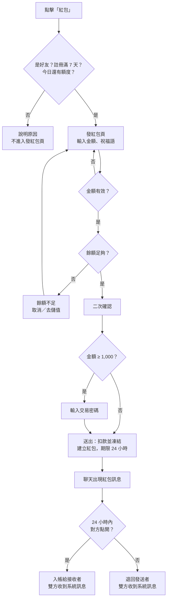

# 一對一發送紅包｜功能規格

| 項目 | 內容 |
|---|---|
| 作答者 | Deciii |
| 日期 | 2026-11-08 |
| 題目 | 在一對一聊天畫面新增「發送紅包」，將指定金額發送給對方 |
| 讀者 | RD（Client／Server）、UI、QA、營運 |
| 版本範圍 | v1.0 本次上線；v1.1 候選：紅包跑馬燈、紅包封面 |

> **閱讀指引**
> 必答：§1 功能目的、§6 原型圖（可點擊）、§7–§10 規格書。
> 加分項：§2 需求調研、§11 埋點、§12 驗證成效的邏輯、§16 AI 使用說明。
> 本文件中的金額、天數、上限皆為示意值，實際數值由營運在後台設定（§10）。

---

## 1. 功能目的

**主要目的：增加好友之間的互動。**
紅包是一種「有理由開口」的互動：送的人表達心意，收的人自然會回應或回禮。一來一往之間，聊天就會延續。

**次要目的：帶動儲值。**
發紅包需要餘額。餘額不足時，引導玩家去儲值，並追蹤這條轉換。但儲值不是設計主軸，所以不在發送流程的其他步驟主動推銷儲值。

**不是目的：讓玩家之間交易或兌換現金。**
因此紅包只能發平台幣、不能提領，並設有發送資格與金額上限（§7.2）。

**成功的樣子**
- 收到紅包的人會回禮
- 有紅包往來的好友，之後聊得更多
- 部分「餘額不足」的玩家完成儲值

---

## 2. 需求調研

### 2.1 類似功能

| 產品 | 金額上限 | 未領取 | 其他觀察 |
|---|---|---|---|
| 微信個人紅包 | 單個上限 200 元。2/14、七夕、5/20 會把一對一上限暫時調到 520 元 | 約 24 小時後退回 | 微信支付產品經理解釋上限的理由：足以表達情誼，又不會給收的人太大壓力 |
| LINE 紅包（台灣） | — | 3 天內未領取，自動退回 | 發出後不能取消；2026/1/1 起，雙方都要完成 LINE Pay Money 註冊與身分驗證；正版紅包訊息不含網址，網址型「紅包」多為詐騙 |
| 社交博弈遊戲的送禮功能 | Club Vegas：每天可送好友至少 2K 籌碼，額度隨等級提高 | — | Gold Fish Casino、Cash Tornado 的送禮只開放給連結 Facebook 的玩家 |

資料來源：[人人都是產品經理](https://www.woshipm.com/pd/3250958.html)、[鳳凰網財經](https://finance.ifeng.com/c/7mknBvI1NKd)、[IT之家](https://www.ithome.com/0/535/381.htm)、[揚子晚報 2026/05/20](https://www.yzwb.net/news/ch/202605/t20260520_354806.html)、[51CTO](https://blog.51cto.com/itstyle/2544764)、[洋蔥網 LINE 紅包教學](https://www.onion-net.com.tw/news_detail/line-red-envelope)、[台灣事實查核中心](https://tfc-taiwan.org.tw/?p=106618)。遊戲送禮的資料，來自我在前一份營運工作中與同事合作的 9 款社交型老虎機競品分析。

### 2.2 我的經驗

我曾擔任海外社交型老虎機手遊的營運負責人。平台幣的價值建立在玩家的信任上：玩家要相信幣不會憑空消失，也不會被大量灌水。所以這份規格特別重視三件事：扣款透明、到期一定退回、防止小號洗幣。

### 2.3 對設計的影響

1. **領取期限 24 小時**：比 LINE 的 3 天短，讓收禮和回禮發生在同一段對話的熱度裡，發送者的錢也不會被凍結太久。
2. **金額上限**：兩者都用上限控制風險與人情壓力。本規格的上限由後台設定，並可比照微信，在節慶活動時暫時調整。
3. **發送資格**：LINE 用身分驗證，遊戲用 Facebook 連結或等級。本規格用「好友＋註冊滿 7 天」，降低開小號洗幣的誘因。
4. **防詐**：祝福語不可包含網址。

---

## 3. 前提與名詞

- **金幣**：平台內的虛擬幣，只能在平台內消費，不能提領或兌換現金。以下用「金幣」稱呼。
- 只開放**一對一聊天**；群組紅包不在範圍內。
- 一對一聊天可能出現「對方不是好友」的情況：例如好友關係解除後，聊天視窗與紀錄仍然保留，聊天中會顯示「你們目前已不是好友」。如果平台也開放陌生人私訊，適用相同規則。
- 平台已有：好友關係、註冊日期、餘額系統、交易密碼、儲值頁、聊天系統訊息。
- 所有時間都以**伺服器時間**為準。

| 名詞 | 定義 |
|---|---|
| 發送者／接收者 | 發紅包的人／一對一聊天中的對方 |
| 待領取 | 已送出、尚未被領取，也還沒過期 |
| 領取期限 | 送出後 24 小時 |
| 今日已發 | 發送者在當天（伺服器日）已送出的紅包總額，退回的紅包也計入 |

---

## 4. 範圍

| 功能 | v1.0 | v1.1 候選 |
|---|:-:|:-:|
| 「＋」面板的紅包入口、發送資格檢查 | ✓ | |
| 發紅包頁（金額、祝福語、即時檢查） | ✓ | |
| 二次確認、超過門檻輸入交易密碼 | ✓ | |
| 餘額不足：取消／去儲值，儲值後保留輸入 | ✓ | |
| 紅包訊息與狀態、系統訊息 | ✓ | |
| 領取、24 小時未領取退回 | ✓ | |
| 縮放動畫 | ✓ | |
| 埋點、A/B 分組、後台參數 | ✓ | |
| 紅包跑馬燈（置頂提醒、「回紅包」按鈕，§7.11） | | ✓ 請 RD 評估能否併入 v1.0 |
| 紅包封面（§7.12） | | ✓ |

**明確不做**：以下是 RD、營運常會問到的延伸功能，先在這裡講清楚。

| 項目 | 不做的原因 |
|---|---|
| 紅包紀錄頁 | 一對一紅包是一份心意，不是需要記帳、日後回禮的禮金；每個紅包的狀態在聊天中就看得到 |
| 群組紅包 | 題目範圍是一對一聊天 |
| 提領成現金 | 紅包只能發平台幣（D2），避免變成玩家之間的交易工具 |
| 撤回已送出的紅包 | 紅包送出即成立；沒被領取的會在 24 小時後自動退回 |

---

## 5. 使用流程

---

## 6. 原型圖

沿用題目提供的聊天畫面，補完點擊「紅包」之後的流程。畫面上的綠色編號對應說明欄與本文件章節；右側的情境按鈕可以切換不同條件。

| 編號 | 畫面 | 對應章節 |
|---|---|---|
| R1 | 聊天頁與「＋」面板 | §7.1 |
| RB | 無法發送 | §7.2 |
| R2 | 發紅包頁 | §7.3 |
| R3 | 二次確認、交易密碼 | §7.4 |
| R4 | 餘額不足 | §7.5 |
| R5 | 聊天中的紅包訊息 | §7.7、§7.9 |
| R6 | 開紅包 | §7.8、§7.10 |

---

## 7. 功能規格

### 7.1 入口
- 紅包按鈕位於聊天輸入列「＋」展開後的面板，與照片、拍照、攝像並列。
- 所有一對一聊天都顯示紅包按鈕，包含好友關係已解除、但聊天紀錄仍在的聊天（§3）；點擊後才檢查資格（§7.2）。
  - **為什麼不直接隱藏**：統一在同一處說明限制原因，玩家不會困惑「為什麼這裡沒有紅包」；也能記錄被擋的次數與原因。
- A/B 對照組不顯示紅包按鈕（§12）。

### 7.2 發送資格
點擊紅包時依序檢查，第一個不符合的條件會跳出提示，不進入發紅包頁：

| 順序 | 條件 | 不符合時的提示 |
|---|---|---|
| 1 | 對方是好友 | 只能發紅包給好友。 |
| 2 | 發送者註冊滿 7 天 | 註冊滿 7 天後才能發紅包（你目前註冊第 N 天）。 |
| 3 | 今日還有額度（今日已發 < 每日上限） | 今天的紅包額度已用完，明天再來吧。 |

單筆上限與今日剩餘額度在發紅包頁即時檢查（§7.3）。客戶端的檢查只是為了體驗，送出時伺服器會全部重新檢查（§8）。

### 7.3 發紅包頁

| 欄位 | 規則 | 提示文字 |
|---|---|---|
| 金額 | 必填，正整數，1 到單筆上限 | 欄位下方顯示「單筆上限 2,000 · 今日還可發 X」 |
| 祝福語 | 選填，最多 20 字；空白時使用預設「恭喜發財，大吉大利」；不可包含網址；依平台既有規則過濾敏感字 | — |
| 可用餘額 | 顯示目前餘額 | 可用餘額 X 金幣 |
| 「塞進紅包」按鈕 | 金額有效且祝福語沒有錯誤時才能按 | — |

即時錯誤提示：

| 情況 | 提示 |
|---|---|
| 金額超過單筆上限 | 單筆上限為 2,000 金幣 |
| 金額超過今日剩餘額度 | 超過今日可發額度，今日還可發 X 金幣 |
| 祝福語含網址 | 祝福語不能包含網址 |

- 金額超過餘額時，**不在輸入當下擋住**，而是按下「塞進紅包」時跳出餘額不足（§7.5），給玩家選擇儲值的機會。
- 點左上角返回，回到聊天頁，不保留輸入內容。

### 7.4 二次確認與交易密碼
- 按「塞進紅包」且餘額足夠時，**一律**跳出確認彈窗，顯示對象、金額、祝福語，按鈕為「取消」「確認發送」。
- 金額 **≥ 1,000** 時，確認後再要求輸入 6 位數交易密碼。輸入錯誤的次數與鎖定，依平台既有的交易密碼規則。
- 尚未設定交易密碼的玩家，依平台既有流程引導設定（不在本次範圍）。

### 7.5 餘額不足
- 彈窗標題「餘額不足」，內容「這次需要 X 金幣，目前餘額 Y，還差 Z 金幣。」
- 按鈕：「取消」（留在發紅包頁，保留輸入）、「去儲值」（開啟既有儲值頁）。
- 從儲值頁回來時（不論是否完成儲值），回到發紅包頁，**保留已輸入的金額與祝福語**，並更新可用餘額。

### 7.6 送出與扣款
- 確認（以及密碼）通過後，伺服器在同一筆交易中：重新檢查資格與上限 → 從發送者餘額扣款並凍結 → 建立紅包（狀態「待領取」，期限 24 小時）→ 寫入交易紀錄。
- 成功：回到聊天頁，出現紅包訊息，並提示「紅包已送出」。
- 失敗：不扣款，提示原因並留在原畫面。

| 失敗原因 | 提示 |
|---|---|
| 送出前對方解除好友 | 對方已不是你的好友，紅包未送出 |
| 送出時已超過上限（例如另一台裝置剛發過） | 已超過今日可發額度，紅包未送出 |
| 密碼錯誤 | 交易密碼錯誤 |
| 系統忙碌 | 網路不穩，紅包未送出，請稍後再試 |

- 紅包送出後不能撤回。

### 7.7 紅包訊息與狀態
紅包訊息顯示祝福語與狀態，**不顯示金額**；金額只有接收者打開後才看得到。

| 狀態 | 發送者看到 | 接收者看到 |
|---|---|---|
| 待領取 | 等待領取 · X 小時 Y 分後退回 | 點擊領取 · 剩 X 小時 Y 分 |
| 已領取 | 已被領取 | 已領取 |
| 已退回 | 已退回 | 已過期 |

- 剩餘時間以分鐘為單位；不到 1 小時只顯示分鐘；停留在聊天頁時每分鐘更新。

系統訊息（顯示在聊天中間）：

| 事件 | 發送者看到 | 接收者看到 |
|---|---|---|
| 領取 | 好友暱稱 領取了你的紅包 | 你領取了 好友暱稱 的紅包 |
| 過期退回 | 紅包已過期，X 金幣已退回你的餘額 | 好友暱稱 的紅包已過期 |

### 7.8 領取
- 接收者點擊待領取的紅包 → 開紅包彈窗（縮放動畫，§7.10），顯示發送者頭像、暱稱、祝福語與「開」按鈕。
- 點「開」→ 伺服器入帳 → 彈窗顯示「X 金幣，已存入你的餘額」→ 雙方收到系統訊息。
- 只有接收者可以領取；同一個紅包只會入帳一次。
- 點擊已領取或已過期的紅包：提示「紅包已領取」或「紅包已過期」。
- 發送者點擊自己的紅包：提示目前狀態。
- 發送後才解除好友：紅包仍可在期限內領取。紅包在送出時已經成立。

### 7.9 過期退回
- 送出 24 小時後仍未領取 → 自動退回發送者餘額 → 雙方收到系統訊息。
- 退回的金額**不會**恢復當天的發送額度，避免用「發了不領、等退回」繞過每日上限。

### 7.10 動畫（給 UI）

| 場景 | 動畫 | 參數 |
|---|---|---|
| 開紅包彈窗出現 | 縮放 | 從 60% 放大到 100%，透明度 0 → 1，約 250ms，ease-out 帶輕微回彈 |
| 新的紅包訊息出現在聊天中 | 縮放 | 從 80% 放大到 100%，約 200ms |
| 系統設定「減少動態效果」 | 不播放 | — |

### 7.11 紅包跑馬燈（v1.1 候選，請 RD 評估能否併入 v1.0）
- **為什麼要做**：紅包訊息很容易被後續聊天洗掉。把它置頂一段時間，可以提醒接收者領取；領取後再顯示收到的金額和「回紅包」按鈕，讓收到紅包的人有一個順手回應的入口，互動也會增加。
- **規則**（只有接收者看得到，置頂在聊天標題列下方）：
  - 有待領取的紅包時：「好友暱稱 送你一個紅包 · 剩 X」，按鈕「打開」。同時有多個時，顯示最早到期的那一個。
  - 領取後 10 分鐘內：「收到 好友暱稱 的紅包 888 金幣了」，按鈕「回紅包」。點了會開啟發紅包頁，一樣要通過資格檢查。
- **文案原則**：只陳述事實，再提供按鈕；不用「回個禮吧」這類讓人有壓力的說法。
- **文案不寫死**：兩段文案都由營運在後台設定（§10）。未領取的文案不能使用金額，因為金額要打開才看得到（D12）。
- **評估重點**：聊天頁是否已有置頂元件可以沿用。

### 7.12 紅包封面（v1.1 候選）
- 發紅包頁增加「選擇封面」，沒有選擇時使用預設封面。
- 聊天中的紅包訊息與開紅包彈窗，都顯示發送者選的封面。
- 封面由營運在後台上架與下架，可以搭配節慶活動推出限定封面。
- **評估重點**：封面素材的尺寸規格與下載方式，需要 UI 與 RD 一起決定。

---

## 8. 伺服器與資料規則（給 RD）

**紅包狀態**：待領取 → 已領取，或 待領取 → 已退回。只有這兩種轉換，且都是不可逆的。

**發送**
- 資格、上限、餘額檢查與扣款在**同一筆交易**中完成；任何一步失敗就整筆回滾，不扣款。
- 客戶端每次送出都帶 `request_id`；重複的請求回傳第一次的結果，不重複扣款。
- 每日上限以伺服器日累計「今日已發」，退回不扣減。

**領取**
- 只有在「待領取」且「未超過期限」時，才能更新為「已領取」；以條件式更新處理並發，只有一個請求會成功。
- 領取時即時比對期限，不依賴過期排程，避免排程延遲時仍能領取已過期的紅包。

**過期**
- 排程每分鐘處理期限已到的「待領取」紅包 → 更新為「已退回」→ 退回發送者。

**交易紀錄**：每筆扣款、入帳、退回都要記錄，供客服查詢與對帳。

| 資料 | 欄位 |
|---|---|
| 紅包 | id、sender_id、receiver_id、amount、message、status、created_at、expire_at、claimed_at、refunded_at、request_id |
| 交易紀錄 | id、user_id、type（rp_send／rp_claim／rp_refund）、amount（正負）、envelope_id、balance_before、balance_after、created_at |

**通知**：狀態改變時，推送系統訊息給雙方（§7.7）。

---

## 9. 例外狀況

| # | 情境 | 系統行為 |
|---|---|---|
| E1 | 送出時網路中斷 | 客戶端以同一個 `request_id` 重試或查詢；只扣款一次 |
| E2 | 送出前對方剛解除好友 | 送出失敗，不扣款（§7.6） |
| E3 | 發送後才解除好友 | 紅包仍可在期限內領取（§7.8） |
| E4 | 接收者在期限的最後一刻點「開」 | 以伺服器收到請求的時間判定；超過期限就提示「紅包已過期」 |
| E5 | 接收者在兩台裝置同時點「開」 | 只入帳一次；另一台顯示「紅包已領取」 |
| E6 | 同一帳號在兩台裝置同時發紅包 | 伺服器依序檢查上限；第二筆若超過上限就失敗、不扣款 |
| E7 | 在發紅包頁停留時跨日 | 以送出當下的伺服器日計算今日額度 |
| E8 | 去儲值後沒有完成儲值就返回 | 回到發紅包頁，保留輸入，餘額不變 |
| E9 | 祝福語含敏感字 | 依平台既有規則過濾；含網址則不能送出 |

---

## 10. 後台參數

| 參數 | 預設（示意） | 說明 |
|---|---|---|
| 發送資格：註冊天數 | 7 天 | |
| 單筆上限 | 2,000 金幣 | 可依節慶活動暫時調整 |
| 每日上限 | 10,000 金幣 | 以伺服器日累計，退回不恢復 |
| 交易密碼門檻 | 1,000 金幣 | 金額達到或超過時要求密碼 |
| 領取期限 | 24 小時 | |
| 祝福語字數上限 | 20 字 | |
| 預設祝福語 | 恭喜發財，大吉大利 | |
| 跑馬燈：領取後顯示時間（v1.1） | 10 分鐘 | |
| 跑馬燈文案：未領取（v1.1） | {暱稱} 送你一個紅包 · 剩 {剩餘時間} | 可用變數：{暱稱}、{剩餘時間}。不能用 {金額}，金額要打開才看得到（D12） |
| 跑馬燈文案：已領取（v1.1） | 收到 {暱稱} 的紅包 {金額} 金幣了 | 可用變數：{暱稱}、{金額} |
| 跑馬燈文案的共同規則 | — | 每段最多 30 字；儲存前可以預覽；使用不支援的變數時無法儲存 |
| A/B 實驗組比例 | 50% | |

---

## 11. 埋點與數據追蹤

| 事件 | 觸發時機 | 主要參數 |
|---|---|---|
| rp_entry_view | 「＋」面板展開，看到紅包按鈕 | chat_id |
| rp_entry_click | 點擊紅包 | chat_id |
| rp_blocked | 資格不符被擋 | reason（not_friend／new_account／daily_used_up） |
| rp_compose_view | 進入發紅包頁 | balance、daily_remaining |
| rp_compose_close | 關閉紅包視窗（返回、取消確認、取消密碼） | step（compose／confirm／password）、amount_entered |
| rp_insufficient_view | 跳出餘額不足 | amount、balance |
| rp_topup_click | 點「去儲值」 | amount、shortfall |
| rp_topup_return | 從儲值頁回到發紅包頁 | topup_amount（未儲值為 0） |
| rp_send_success | 發送成功 | envelope_id、amount、balance_before、balance_after、custom_message（是否自訂祝福語） |
| rp_send_fail | 發送失敗 | reason（limit／not_friend／password／server）、amount |
| rp_open_view | 接收者打開開紅包彈窗 | envelope_id、seconds_since_send |
| rp_claim | 領取成功 | envelope_id、amount、seconds_since_send |
| rp_refund | 過期退回 | envelope_id、amount |
| rp_marquee_view／rp_marquee_click | 跑馬燈出現／被點擊（v1.1） | type（unclaimed：未領取／claimed：已領取） |

**漏斗**：rp_entry_view → rp_entry_click → rp_compose_view → rp_send_success。每一步的流失原因，可以用 rp_blocked、rp_compose_close（step）、rp_insufficient_view 拆開來看。

**「使用了多少餘額」**：rp_send_success 的 amount、balance_before、balance_after。

---

## 12. 驗證成效的邏輯

**假設**：一對一紅包會增加好友之間的互動，並帶動部分儲值。

**實驗設計：以「發送者」分組的 A/B Test**
- 依玩家 ID 隨機分組：50% 實驗組看得到紅包按鈕，50% 對照組看不到；**所有人都能領取**。觀察 2 週。
- **為什麼以發送者分組**：紅包有網路效果，對照組的人也可能收到紅包。所以實驗變因是「能不能發」；接收者的行為另外分析。

| 類型 | 指標 | 怎麼判斷 |
|---|---|---|
| 主要 | 人均一對一聊天訊息數、有聊天的好友數（實驗組 vs 對照組） | 實驗組顯著較高，代表紅包帶動了互動 |
| 主要 | 紅包往來前後 7 天，該好友對的聊天訊息數變化 | 往來之後增加，代表互動延續 |
| 主要 | 回禮率：收到紅包後 24 小時內，回送紅包給同一人的比例 | 作為 v1.1 跑馬燈的基準值 |
| 次要 | 「餘額不足 → 去儲值 → 儲值成功」的轉換；兩組的儲值人數 | 只追蹤，不作為成敗標準 |
| 漏斗 | 看到 → 點擊 → 進入 → 送出 的各步驟流失；領取率、平均領取時間 | 找出卡關的步驟 |
| 護欄 | 被擋次數與原因；同一對帳號高頻、大額往來；紅包相關客訴 | 出現異常就調整上限或資格 |

**看完數據之後**
- 互動提升 → 全面開放，並評估跑馬燈。
- 互動沒有提升、但儲值有提升 → 重新檢視功能定位，再決定是否全面開放。
- 回禮率低、領取時間長 → 優先做跑馬燈。
- 護欄指標異常 → 先調整上限與資格，再擴大開放。

---

## 13. 驗收條件

| # | 情境（Given） | 動作（When） | 結果（Then） |
|---|---|---|---|
| AC1 | 對照組玩家 | 展開「＋」面板 | 看不到紅包按鈕 |
| AC2 | 好友關係已解除，聊天紀錄仍在 | 點擊紅包 | 提示「只能發紅包給好友。」，不進入發紅包頁，記錄 rp_blocked |
| AC3 | 發送者註冊第 3 天 | 點擊紅包 | 提示需註冊滿 7 天，不進入發紅包頁 |
| AC4 | 在發紅包頁 | 輸入 2,001 | 顯示「單筆上限為 2,000 金幣」，「塞進紅包」不能按 |
| AC5 | 今日已發 9,500 | 輸入 600 | 顯示「今日還可發 500 金幣」，「塞進紅包」不能按 |
| AC6 | 餘額 800 | 輸入 1,000 並按「塞進紅包」 | 跳出餘額不足；去儲值回來後，金額與祝福語仍在 |
| AC7 | 餘額足夠 | 送出 500／送出 1,000 | 500：確認後直接送出；1,000：確認後要求交易密碼 |
| AC8 | 送出成功 | — | 餘額立即減少；聊天出現紅包訊息，發送者看到退回剩餘時間 |
| AC9 | 送出時網路中斷 | 客戶端重試 | 只扣款一次 |
| AC10 | 接收者點擊待領取的紅包 | 點「開」 | 彈窗以縮放動畫出現；入帳並顯示金額；雙方收到系統訊息 |
| AC11 | 接收者在兩台裝置同時點「開」 | — | 只入帳一次 |
| AC12 | 送出後 24 小時未領取 | — | 退回發送者餘額；雙方收到系統訊息；今日已發的額度不變 |
| AC13 | 祝福語輸入網址 | — | 顯示「祝福語不能包含網址」，不能送出 |

---

## 14. 開發拆分

| ID | 項目 | 對應 | 優先級 |
|---|---|---|---|
| B1 | Server：資格與上限檢查 | §7.2、§8 | Must |
| B2 | Server：發送扣款、建立紅包、交易紀錄、request_id | §7.6、§8 | Must |
| B3 | Server：領取與並發控制 | §7.8、§8 | Must |
| B4 | Server：過期退回排程 | §7.9、§8 | Must |
| B5 | Client：紅包入口與資格提示 | §7.1、§7.2 | Must |
| B6 | Client：發紅包頁與即時檢查 | §7.3 | Must |
| B7 | Client：二次確認與交易密碼 | §7.4 | Must |
| B8 | Client：餘額不足與儲值返回 | §7.5 | Must |
| B9 | Client：紅包訊息狀態與系統訊息 | §7.7 | Must |
| B10 | Client：開紅包彈窗與縮放動畫 | §7.8、§7.10 | Must |
| B11 | 後台參數 | §10 | Must |
| B12 | 埋點、報表、A/B 分組 | §11、§12 | Must |
| B13 | 紅包跑馬燈 | §7.11 | v1.1 候選，請 RD 評估 |
| B14 | 紅包封面 | §7.12 | v1.1 候選 |

---

## 15. 決策紀錄

| # | 問題 | 決定 | 理由 |
|---|---|---|---|
| D1 | 主要目的？ | 互動；儲值為次要目標並追蹤 | 紅包的價值在於讓好友之間有來有往 |
| D2 | 發送的是什麼？ | 平台幣，只能在平台內消費，不能提領 | 避免變成玩家之間的交易工具 |
| D3 | 何時入帳？ | 接收者點開才入帳；24 小時未領取退回 | 讓「打開」本身成為一次互動；不讓金額長期懸空 |
| D4 | 誰可以發？ | 好友、註冊滿 7 天、未超過單筆與每日上限 | 降低小號洗幣與帳號交易的誘因 |
| D5 | 如何確認？ | 一律二次確認；達 1,000 以上需要交易密碼 | 避免誤發；大額再加一道驗證 |
| D6 | 餘額不足？ | 提供「取消」與「去儲值」，儲值後保留輸入 | 給玩家選擇；儲值是次要目標，不強推 |
| D7 | 紅包被聊天洗掉？ | 跑馬燈列為 v1.1 候選，請 RD 評估能否併入 | 提醒領取並刺激回禮，但不影響 v1.0 時程 |
| D8 | MVP 的呈現？ | 祝福語，加上縮放動畫 | 最低限度也要有「打開禮物」的感覺 |
| D9 | 紀錄頁、封面？ | 紀錄頁不做；封面與跑馬燈一起列為 v1.1 候選 | 紅包是一份心意，不是需要記帳回禮的禮金；封面可以搭配節慶活動，但不影響 v1.0 驗證互動 |
| D10 | 退回後要恢復當日額度嗎？ | 不恢復 | 避免用「發了不領、等退回」繞過上限 |
| D11 | 發送後解除好友？ | 仍可在期限內領取 | 紅包在送出時已經成立 |
| D12 | 訊息顯示金額嗎？ | 不顯示，打開才看得到 | 保留驚喜，也減少金額比較的壓力 |
| D13 | 跑馬燈領取後的文案？ | 「收到 好友暱稱 的紅包 888 金幣了」＋「回紅包」按鈕；兩段文案都由後台設定 | 只陳述事實，不給收紅包的人壓力；營運可以依活動調整，不必改版 |

---

## 16. AI 使用說明

- **工具**：Claude（Anthropic），在 Claude Code 桌面版中使用。
- **AI 協助的部分**：
  - 需求調研：搜尋並整理微信、LINE 紅包的公開規則
  - 規格書的結構與文字整理
  - 製作可點擊原型的網頁
  - 檢查規則之間是否有矛盾，例如退回是否恢復額度、過期與領取同時發生
- **由我決定的部分**：功能目的與優先順序、入帳與退回規則、發送資格與上限、二次確認與密碼門檻、餘額不足的處理、跑馬燈的動機與版本、動畫要求、埋點事件清單、不做紀錄頁、封面列為 v1.1 候選、跑馬燈文案不施壓且由後台設定（D13）。
- **AI 提出建議、經我確認的部分**：退回不恢復當日額度、發送後解除好友仍可領取、紅包訊息不顯示金額（§15 D10–D12），以及「明確不做」清單中的群組紅包、提領、撤回。
- **我過去的營運經驗帶進來的部分**：平台幣信任、洗幣風險、社交博弈遊戲的送禮競品資料。
